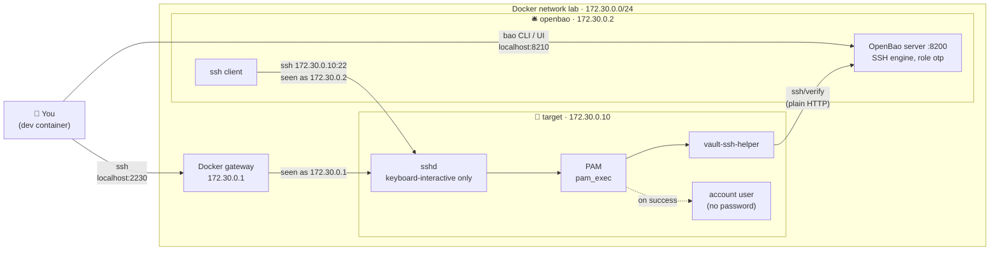

# OpenBao SSH: one-time passwords (OTP) lab

A small lab where an SSH server accepts **only** one-time passwords issued by OpenBao. No shared passwords, no SSH keys: every login gets a fresh password that works exactly once.

## What's in the lab



| Service | Inside the lab | From the dev container | Config |
|---|---|---|---|
| OpenBao 2.7.1 + ssh client | `172.30.0.2:8200` | `localhost:8210` | [`bao/`](bao/) (`bao.hcl`, `Dockerfile`) |
| SSH target | `172.30.0.10:22` | `localhost:2230` | [`target/`](target/) |

## Quick start

```sh
docker compose up -d --build
export BAO_ADDR=http://127.0.0.1:8210
bao operator init && bao operator unseal   # unseal 3 times, then: bao login
bao secrets enable ssh
bao write ssh/roles/otp key_type=otp default_user=user allowed_users=user cidr_list=172.30.0.0/24

bao write -field=key ssh/creds/otp ip=172.30.0.10   # prints an OTP
ssh -p 2230 user@localhost                          # paste it
```

## Use it on a real server

You need a Debian or Ubuntu server with `openssh-server`, an OpenBao reachable from it over HTTPS, and the CA certificate that signed OpenBao's TLS certificate. Run these **on the server**, and keep your current SSH session open until step 5 works:

**1. Download the script** from the latest release, and check it arrived intact:

```sh
mkdir otp-setup && cd otp-setup
curl -fsSLO https://github.com/muthanii/otp-lab/releases/latest/download/setup-otp-target.sh
curl -fsSLO https://github.com/muthanii/otp-lab/releases/latest/download/SHA256SUMS
sha256sum -c SHA256SUMS && chmod +x setup-otp-target.sh
```

To pin a version, replace `latest/download` with `download/v0.2.0` (or any release from 0.2.0 on).

**2. Get `vault-ssh-helper`.** The script builds it if Go is installed on the server. Otherwise, copy over the one from the lab (the server must have the same CPU architecture, usually `amd64`):

```sh
# in the dev container, from the otp-lab folder:
docker compose cp target:/usr/local/bin/vault-ssh-helper .
scp vault-ssh-helper ca.pem <you>@<server>:otp-setup/
```

**3. Create the OTP accounts** (non-admins only) and run the script:

```sh
sudo useradd -m -s /bin/bash alice && sudo usermod -p '*' alice   # no usable password, like the lab
sudo groupadd -f otp-users && sudo usermod -aG otp-users alice
sudo ./setup-otp-target.sh --bao-addr https://bao.example.com:8200 \
     --ca-cert ca.pem --roles otp --helper ./vault-ssh-helper
```

The script prints the server's IP at the end, and warns about any `otp-users` member that has admin or sudo rights.

**4. In OpenBao**, allow only those accounts and only this server's IP:

```sh
bao write ssh/roles/otp key_type=otp default_user=alice allowed_users=alice cidr_list=<server IP>/32
```

**5. Test from a second terminal:**

```sh
bao write -field=key ssh/creds/otp ip=<server IP>   # prints an OTP
ssh alice@<server>                                  # paste it
```

Use the IP the script printed, even if you connect to the server by a different public address. All options, the safety checks and how to undo the changes are in [Setting up a real server](docs/real-server.md).

## Docs

| Page | Covers |
|---|---|
| [Running the lab](docs/running-the-lab.md) | Setup step by step, limited tokens, logging in from either container, troubleshooting, tear down |
| [How it works](docs/how-it-works.md) | Login sequence, why OTPs can't be reused, what the target checks, which files get written, OTP vs signed keys |
| [Setting up a real server](docs/real-server.md) | The [`setup-otp-target.sh`](scripts/setup-otp-target.sh) script, what changes from the lab, and what to watch out for |

## Versioning

Versions follow [semver](https://semver.org/); see [CHANGELOG.md](CHANGELOG.md) for what changed in each release.

## License

[Apache-2.0](LICENSE)
