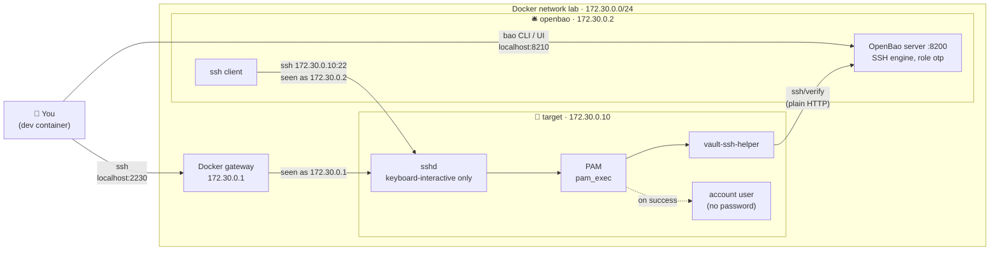

# OpenBao SSH: one-time passwords (OTP) lab

A small lab where an SSH server accepts **only** one-time passwords issued by OpenBao. No shared passwords, no SSH keys: every login gets a fresh password that works exactly once.

## What's in the lab



| Service | Inside the lab | From the dev container | Config |
|---|---|---|---|
| OpenBao 2.7.1 + ssh client | `172.30.0.2:8200` | `localhost:8210` | [`bao/`](bao/) (`bao.hcl`, `Dockerfile`) |
| SSH target | `172.30.0.10:22` | `localhost:2230` | [`target/`](target/) |

## Quick start

```sh
docker compose up -d --build
export BAO_ADDR=http://127.0.0.1:8210
bao operator init && bao operator unseal   # unseal 3 times, then: bao login
bao secrets enable ssh
bao write ssh/roles/otp key_type=otp default_user=user allowed_users=user cidr_list=172.30.0.0/24

bao write -field=key ssh/creds/otp ip=172.30.0.10   # prints an OTP
ssh -p 2230 user@localhost                          # paste it
```

## Use it on a real server

On a Debian or Ubuntu server that can reach your OpenBao over HTTPS, one script does the setup: it installs `openssh-server` if needed, downloads `vault-ssh-helper` for the server's CPU and checks its checksum, creates the OTP accounts you name, and connects the server's SSH to OpenBao through PAM. Keep your current SSH session open until step 5 works.

**1. Download the script** on the server with `wget`, check it arrived intact, and make it executable:

```sh
wget -q https://github.com/muthanii/otp-lab/releases/latest/download/setup-otp-target.sh
wget -q https://github.com/muthanii/otp-lab/releases/latest/download/SHA256SUMS
sha256sum -c --ignore-missing SHA256SUMS      # should print: setup-otp-target.sh: OK
chmod +x setup-otp-target.sh
```

If `wget` is missing, install it with `sudo apt-get install -y wget`. To pin a version, replace `latest/download` with `download/vX.Y.Z`, for example `download/v0.4.0`. `--help` needs 0.4.0 or later, and `--users` needs 0.3.0 or later.

**2. Read the help.** It works without root and changes nothing:

```sh
./setup-otp-target.sh --help        # or: ./setup-otp-target.sh -h
```

<details>
<summary>What <code>--help</code> prints</summary>

```text
setup-otp-target.sh v0.4.1
Turn a Debian/Ubuntu server into an OpenBao SSH OTP target. Run as root, and keep
an existing SSH session open until an OTP login works from a second terminal.

Usage:
  sudo ./setup-otp-target.sh --bao-addr URL --users LIST [options]
  wget -qO- https://github.com/muthanii/otp-lab/releases/latest/download/setup-otp-target.sh \
    | sudo bash -s -- --bao-addr URL --users LIST [options]

Required:
  --bao-addr URL     OpenBao's address, https://
  --users LIST       comma-separated OTP accounts; created with no usable password
                     if missing, refused if root, system (uid < 1000) or admin accounts

Options:
  --ca-cert FILE     CA that signed OpenBao's certificate (default: system's trusted CAs)
  --roles LIST       OpenBao roles allowed for this server (default: otp)
  --mount PATH       SSH engine mount path (default: ssh)
  --helper FILE      use this vault-ssh-helper instead of downloading it from the release
  --otp-group NAME   only members may log in with an OTP (default: otp-users)
  --otp-only         also turn off public-key login (default: keys keep working)
  --insecure-http    allow plain HTTP to OpenBao; labs only
  -h, --help         show this help and exit

OTP logins are refused for root, system accounts, accounts outside --otp-group and
members of the sudo, admin and wheel groups, so an OTP can never open an account
that can create admins.
```

</details>

Every argument in detail:

| Argument | Required? | Default | What it does | Example |
|---|---|---|---|---|
| `--bao-addr URL` | **Yes** | — | Where OpenBao is. Must start with `https://` unless you also pass `--insecure-http`. The server must be able to reach it at every OTP login | `--bao-addr https://bao.example.com:8200` |
| `--users LIST` | **Yes** | — | Comma-separated accounts that may log in with an OTP. Missing ones are created with no usable password; existing ones are only added to the OTP group. The script stops before changing anything if one is `root`, a system account (uid below 1000), in `sudo`/`admin`/`wheel`, or has sudo rules. Use the OpenBao role's `default_user` | `--users user` or `--users ops,deploy` |
| `--ca-cert FILE` | No | The server's trusted CAs | The CA certificate that signed OpenBao's TLS certificate. Only needed when OpenBao uses your own CA instead of a public one like Let's Encrypt | `--ca-cert ./ca.pem` |
| `--roles LIST` | No | `otp` | Comma-separated OpenBao roles whose OTPs this server accepts. An OTP from any other role is rejected | `--roles prod-otp` |
| `--mount PATH` | No | `ssh` | Where the SSH secrets engine is enabled in OpenBao (`bao secrets enable -path=…`) | `--mount ssh-prod` |
| `--helper FILE` | No | Download from the release | Use a `vault-ssh-helper` binary you already have, for servers that can't reach GitHub. Without it, the script downloads the one for this CPU (amd64 or arm64) and checks its checksum | `--helper ./vault-ssh-helper` |
| `--otp-group NAME` | No | `otp-users` | The Linux group whose members may log in with an OTP. Created if missing; `--users` accounts are added to it | `--otp-group ssh-otp` |
| `--otp-only` | No | Off | Also turn off SSH key logins, so OTP is the only way in. Without it, keys keep working, which is your way back in if OpenBao is down | `--otp-only` |
| `--insecure-http` | No | Off | Allow `http://` for `--bao-addr`, sending OTPs unencrypted. **Labs only** | `--insecure-http` |
| `-h`, `--help` | No | — | Show the help and exit, without changing anything | `--help` |

**3. Run it as root:**

```sh
sudo ./setup-otp-target.sh --bao-addr https://bao.example.com:8200 --users user
```

Or download and run in one step, without keeping a copy (no checksum check or help this way):

```sh
wget -qO- https://github.com/muthanii/otp-lab/releases/latest/download/setup-otp-target.sh \
  | sudo bash -s -- --bao-addr https://bao.example.com:8200 --users user
```

**4. In OpenBao**, run the `bao write ssh/roles/...` command the script prints at the end, filled in with this server's IP and the `--users` accounts. If the role already serves other servers, add this server's IP to its `cidr_list` instead of replacing it.

**5. Test from a second terminal**, using the IP the script printed (even if you connect by a different public address):

```sh
bao write -field=key ssh/creds/otp ip=<server IP>   # prints an OTP
ssh <name>@<server>                                 # paste it
```

The safety checks, what each step changes and how to undo it are in [Setting up a real server](docs/real-server.md).

## Docs

| Page | Covers |
|---|---|
| [Running the lab](docs/running-the-lab.md) | Setup step by step, limited tokens, logging in from either container, troubleshooting, tear down |
| [How it works](docs/how-it-works.md) | Login sequence, why OTPs can't be reused, what the target checks, which files get written, OTP vs signed keys |
| [Setting up a real server](docs/real-server.md) | The [`setup-otp-target.sh`](scripts/setup-otp-target.sh) script, what changes from the lab, and what to watch out for |

## Versioning

Versions follow [semver](https://semver.org/); see [CHANGELOG.md](CHANGELOG.md) for what changed in each release.

## License

[Apache-2.0](LICENSE)
