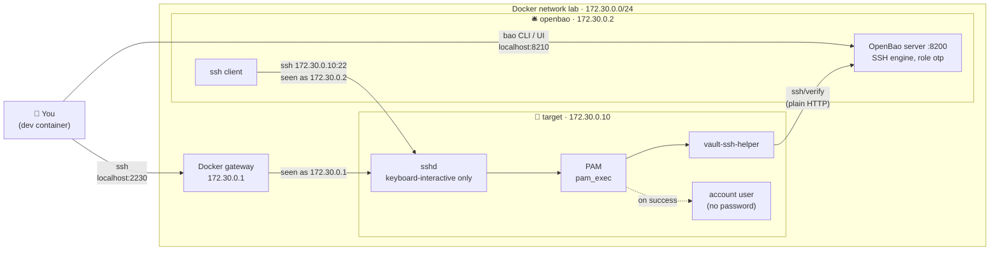

# OpenBao SSH: one-time passwords (OTP) lab

A small lab where an SSH server accepts **only** one-time passwords issued by OpenBao. No shared passwords, no SSH keys: every login gets a fresh password that works exactly once.

## What's in the lab



| Service | Inside the lab | From the dev container | Config |
|---|---|---|---|
| OpenBao 2.7.1 + ssh client | `172.30.0.2:8200` | `localhost:8210` | [`bao/`](bao/) (`bao.hcl`, `Dockerfile`) |
| SSH target | `172.30.0.10:22` | `localhost:2230` | [`target/`](target/) |

## Quick start

```sh
docker compose up -d --build
export BAO_ADDR=http://127.0.0.1:8210
bao operator init && bao operator unseal   # unseal 3 times, then: bao login
bao secrets enable ssh
bao write ssh/roles/otp key_type=otp default_user=user allowed_users=user cidr_list=172.30.0.0/24

bao write -field=key ssh/creds/otp ip=172.30.0.10   # prints an OTP
ssh -p 2230 user@localhost                          # paste it
```

## Use it on a real server

On a Debian or Ubuntu server that can reach your OpenBao over HTTPS, one command does the setup: it installs `openssh-server` if needed, downloads `vault-ssh-helper` for the server's CPU and checks its checksum, and connects the server's SSH to OpenBao through PAM. It doesn't create any accounts. Keep your current SSH session open until step 4 works.

**1. On the server**, run the script from the latest release:

```sh
curl -fsSL https://github.com/muthanii/otp-lab/releases/latest/download/setup-otp-target.sh \
  | sudo bash -s -- --bao-addr https://bao.example.com:8200
```

Add `--ca-cert ca.pem` if OpenBao's certificate comes from your own CA rather than a public one. To read the script before running it, or to pin a version, download it first and check it:

```sh
curl -fsSLO https://github.com/muthanii/otp-lab/releases/download/v0.2.0/setup-otp-target.sh
curl -fsSLO https://github.com/muthanii/otp-lab/releases/download/v0.2.0/SHA256SUMS
sha256sum -c --ignore-missing SHA256SUMS
sudo bash setup-otp-target.sh --bao-addr https://bao.example.com:8200
```

**2. Choose who can log in with an OTP.** Add existing, non-admin accounts to the `otp-users` group, then rerun the script so it can check them and fill in the role command:

```sh
sudo usermod -aG otp-users <name>
```

**3. In OpenBao**, run the `bao write ssh/roles/...` command the script prints at the end. It's filled in with this server's IP and only the accounts that passed the admin check.

**4. Test from a second terminal**, using the IP the script printed (even if you connect by a different public address):

```sh
bao write -field=key ssh/creds/otp ip=<server IP>   # prints an OTP
ssh <name>@<server>                                 # paste it
```

All options, the safety checks and how to undo the changes are in [Setting up a real server](docs/real-server.md).

## Docs

| Page | Covers |
|---|---|
| [Running the lab](docs/running-the-lab.md) | Setup step by step, limited tokens, logging in from either container, troubleshooting, tear down |
| [How it works](docs/how-it-works.md) | Login sequence, why OTPs can't be reused, what the target checks, which files get written, OTP vs signed keys |
| [Setting up a real server](docs/real-server.md) | The [`setup-otp-target.sh`](scripts/setup-otp-target.sh) script, what changes from the lab, and what to watch out for |

## Versioning

Versions follow [semver](https://semver.org/); see [CHANGELOG.md](CHANGELOG.md) for what changed in each release.

## License

[Apache-2.0](LICENSE)
