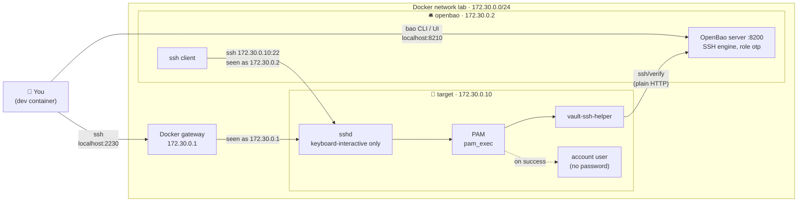

# OpenBao SSH: one-time passwords (OTP) lab

A small lab where an SSH server accepts **only** one-time passwords issued by OpenBao. No shared passwords, no SSH keys: every login gets a fresh password that works exactly once.

## What's in the lab



| Service | Inside the lab | From the dev container | Config |
|---|---|---|---|
| OpenBao 2.7.1 + ssh client | `172.30.0.2:8200` | `localhost:8210` | [`bao/`](bao/) (`bao.hcl`, `Dockerfile`) |
| SSH target | `172.30.0.10:22` | `localhost:2230` | [`target/`](target/) |

## Quick start

```sh
docker compose up -d --build
export BAO_ADDR=http://127.0.0.1:8210
bao operator init && bao operator unseal   # unseal 3 times, then: bao login
bao secrets enable ssh
bao write ssh/roles/otp key_type=otp default_user=user cidr_list=172.30.0.0/24

bao write -field=key ssh/creds/otp ip=172.30.0.10   # prints an OTP
ssh -p 2230 user@localhost                          # paste it
```

## Docs

| Page | Covers |
|---|---|
| [Running the lab](docs/running-the-lab.md) | Setup step by step, limited tokens, logging in from either container, troubleshooting, tear down |
| [How it works](docs/how-it-works.md) | Login sequence, why OTPs can't be reused, what the target checks, which files get written, OTP vs signed keys |
| [Setting up a real server](docs/real-server.md) | The [`setup-otp-target.sh`](scripts/setup-otp-target.sh) script, what changes from the lab, and what to watch out for |

## Versioning and releases

The project follows [Semantic Versioning](https://semver.org/). The current version is in [`VERSION`](VERSION), and changes are listed in [`CHANGELOG.md`](CHANGELOG.md).

| Bump | When |
|---|---|
| Major (`1.0.0` → `2.0.0`) | Something users rely on changes: IPs, ports, the login account, or a removed or renamed script option |
| Minor (`0.1.0` → `0.2.0`) | New features, script options or docs pages that don't break anything |
| Patch (`0.1.0` → `0.1.1`) | Fixes and doc corrections |

To release, update `VERSION`, move the `[Unreleased]` notes in `CHANGELOG.md` under the new version, commit, then tag and push:

```sh
git tag -a v0.2.0 -m "v0.2.0"
git push origin main v0.2.0
```

The [release workflow](.github/workflows/release.yml) checks that the tag matches `VERSION` and creates a GitHub release from that version's changelog section.

## License

[Apache-2.0](LICENSE)
