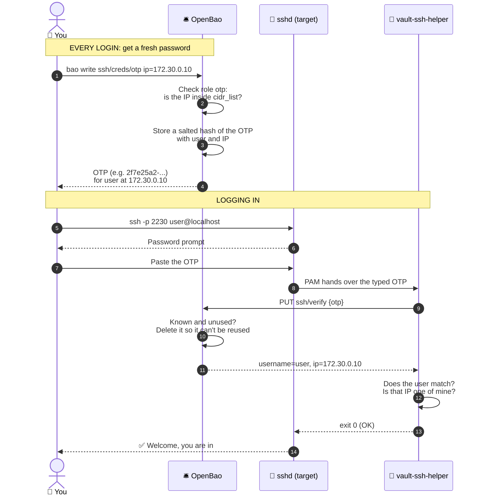
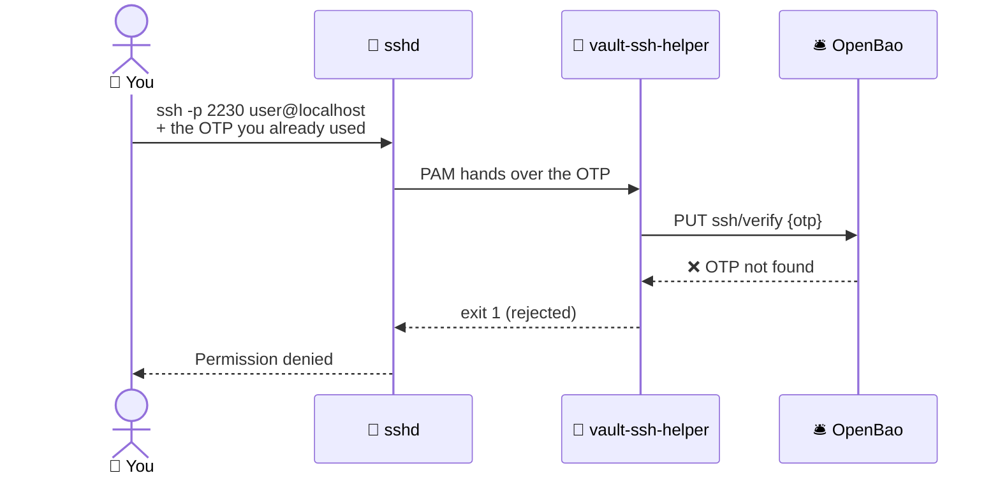
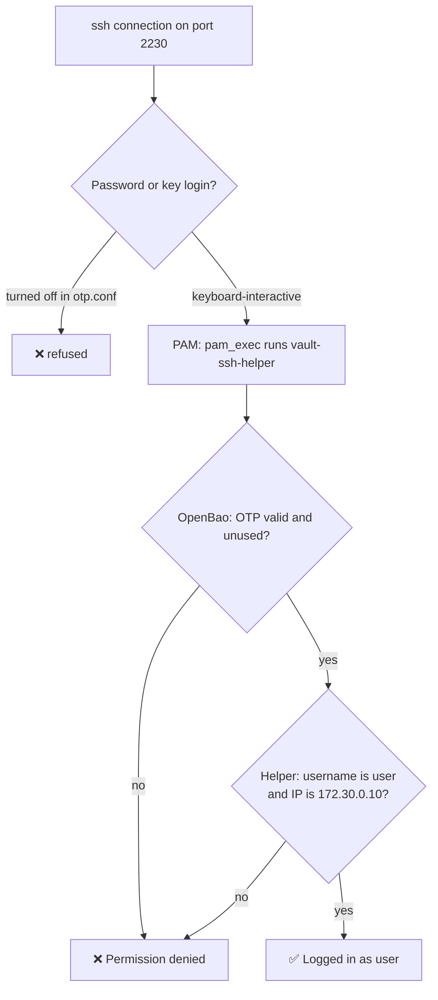
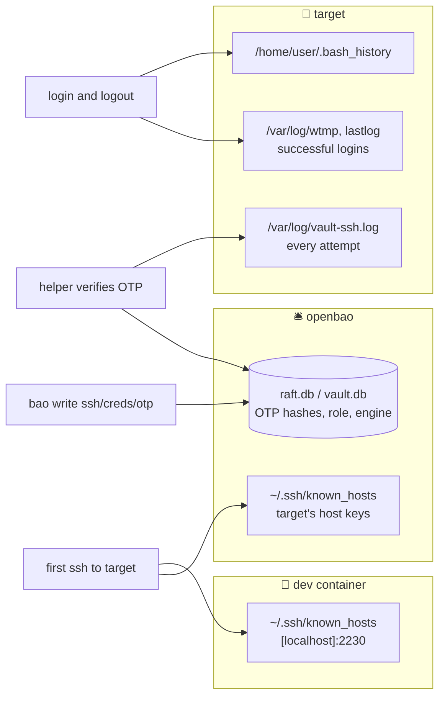

# How it works

[← Back to README](../README.md)

## How an OTP login works

## Why the same OTP fails the second time

OpenBao deletes an OTP the moment it is verified, so reusing one goes like this:

## What the target checks, in order

The PAM step is `requisite`, and the normal Linux password check (`common-auth`) is left out, so a failed OTP ends the login with no fallback. The `user` account has its password set to `*`, so no typed password could ever work on its own.

## Which IP the OTP is for

The target sees each client at a different address: traffic through the published port arrives from Docker's gateway (`172.30.0.1`), and traffic from the OpenBao container arrives straight from `172.30.0.2`. Both work, because the IP inside an OTP is the **target's** address, not the client's. It answers "which server is this OTP for?", not "who is logging in?".

## What gets written where

| Machine | You create (setup) | Created by each login |
|---|---|---|
| OpenBao | [`bao/bao.hcl`](../bao/bao.hcl), [`bao/Dockerfile`](../bao/Dockerfile). The engine and role live in its storage, not in files | An OTP hash in `raft.db`, deleted again on use. There's no file per OTP |
| target | [`target/`](../target/): `Dockerfile`, `config.hcl`, `pam-sshd`, `otp.conf` | A block in `/var/log/vault-ssh.log` (the first place to look when a login fails), login records, shell history |
| Whoever runs `ssh` | Nothing | A `known_hosts` entry the first time. Rebuilding the target gives it new host keys, so expect a "host key changed" warning |

## OTP vs signed keys

| | OTP (this lab) | Signed keys |
|---|---|---|
| What you bring | Nothing, just ask OpenBao | Your own key pair |
| What OpenBao gives you | A password that works once | A certificate valid for a set time |
| OpenBao needed at login time? | **Yes**, the server asks it every time | No, the server checks the signature itself |
| Extra software on the server | `vault-ssh-helper` + PAM changes | Just `TrustedUserCAKeys` in sshd |
| Password is sent over the network | Yes, so use TLS outside a lab | No |
