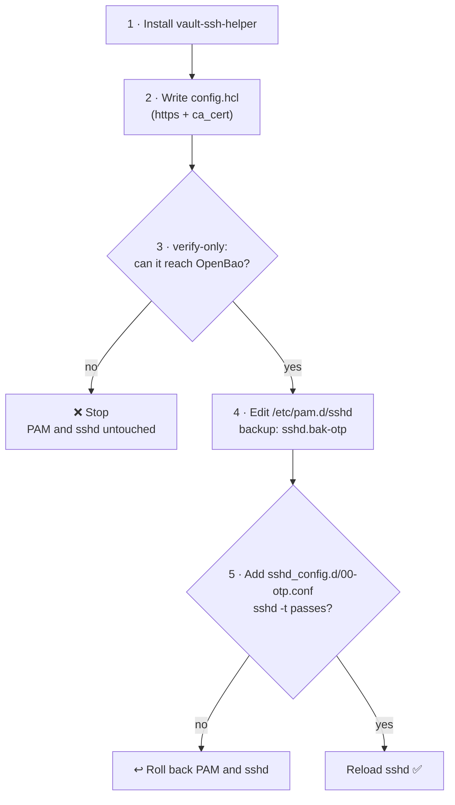

# Setting up a real server

[← Back to README](../README.md)

On a real Debian or Ubuntu server, [`scripts/setup-otp-target.sh`](../scripts/setup-otp-target.sh) does what [`target/Dockerfile`](../target/Dockerfile) does for the lab. Copy the script and a `vault-ssh-helper` binary to the server, then run as root:

```sh
sudo ./setup-otp-target.sh --bao-addr https://bao.example.com:8200 \
     --ca-cert ca.pem --roles otp --helper ./vault-ssh-helper
```

## What the script does



| Option | Meaning |
|---|---|
| `--bao-addr URL` | OpenBao's address (required) |
| `--ca-cert FILE` | CA that signed OpenBao's TLS certificate (required unless `--insecure-http`) |
| `--roles LIST` | Comma-separated OpenBao roles allowed for this server (default `otp`) |
| `--helper FILE` | A `vault-ssh-helper` binary. Without it, the script builds one with Go |
| `--mount PATH` | SSH engine mount path (default `ssh`) |
| `--otp-only` | Also turn off public-key login |
| `--insecure-http` | Allow plain HTTP to OpenBao. Labs only |

## How the lab files map to a real server

| Lab file | On a real server |
|---|---|
| [`target/config.hcl`](../target/config.hcl) | Written by the script, with `https://`, `ca_cert` and the role names you pass |
| [`target/pam-sshd`](../target/pam-sshd) | **Not copied.** The script edits the existing `/etc/pam.d/sshd` and swaps `common-auth` for the OTP check, without `-dev` |
| [`target/otp.conf`](../target/otp.conf) | Written as `00-otp.conf`, so it wins over drop-ins like `50-cloud-init.conf` that turn password login back on |
| [`target/Dockerfile`](../target/Dockerfile) | Not used. The script installs the helper, and the login accounts must already exist |

## Before and after running it

- **Keep your current SSH session open** until an OTP login works from a second terminal. To undo the PAM change: `cp /etc/pam.d/sshd.bak-otp /etc/pam.d/sshd`.
- **Public-key login keeps working** unless you pass `--otp-only`. That's your way in if OpenBao is down, because the server asks OpenBao at every OTP login.
- **Use the server's own interface IP** in the role's `cidr_list` and when requesting OTPs. A cloud VM behind NAT knows its private IP (e.g. `10.0.1.5`), not the public one you connect to. The script prints the right one at the end.
- **Name the role in `--roles`** rather than `*`, and give people a limited policy (see [running the lab](running-the-lab.md#a-token-that-can-only-request-otps-optional)) instead of the root token.

## Lab-only shortcuts

These are fine for the lab but not for a real server:

- OpenBao listens on plain HTTP (`tls_disable = true`), and the helper runs with `-dev` so it accepts that. For anything real, turn on TLS and give the helper a `ca_cert`.
- `allowed_roles = "*"` lets any OpenBao role issue OTPs for the target.
- Public-key login is off in [`target/otp.conf`](../target/otp.conf), so OTP is the only way in.
- The OpenBao container has an ssh client so it can act as the client. A real OpenBao server wouldn't run one.
- `vault-ssh-helper` is built from source in [`target/Dockerfile`](../target/Dockerfile) because HashiCorp's download site is geo-blocked here.
