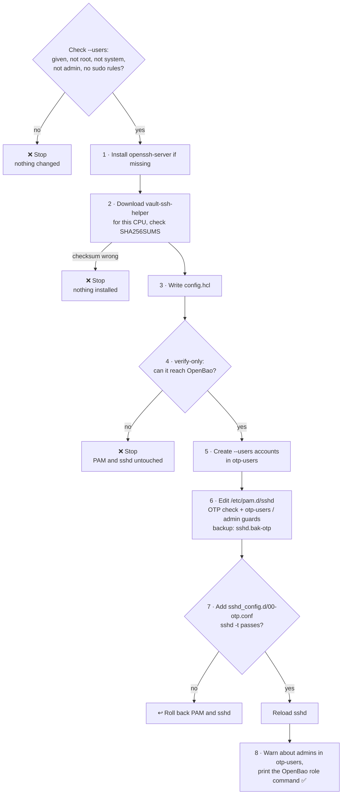

# Setting up a real server

[← Back to README](../README.md)

On a real Debian or Ubuntu server, [`scripts/setup-otp-target.sh`](../scripts/setup-otp-target.sh) does what [`target/Dockerfile`](../target/Dockerfile) does for the lab. Each [release](https://github.com/muthanii/otp-lab/releases/latest) ships the script, `vault-ssh-helper` for amd64 and arm64, and `SHA256SUMS`, so the server needs nothing but `wget` (or `curl`):

```sh
wget -qO- https://github.com/muthanii/otp-lab/releases/latest/download/setup-otp-target.sh \
  | sudo bash -s -- --bao-addr https://bao.example.com:8200 --users user
```

The [README](../README.md#use-it-on-a-real-server) shows how to download and check the script first, read `--help`, every argument in detail, and how to pin a version.

## What the script does



| Option | Meaning |
|---|---|
| `--bao-addr URL` | OpenBao's address, `https://` (required) |
| `--users LIST` | Comma-separated OTP accounts (required). Missing ones are created with no usable password; the script refuses `root`, system accounts (uid below 1000), and accounts with admin groups or sudo rules |
| `--ca-cert FILE` | CA that signed OpenBao's certificate. Leave it out if the certificate comes from a public CA |
| `--roles LIST` | Comma-separated OpenBao roles allowed for this server (default `otp`) |
| `--helper FILE` | Use this `vault-ssh-helper` binary instead of downloading one. If the download fails, the script builds one with Go, if installed |
| `--mount PATH` | SSH engine mount path (default `ssh`) |
| `--otp-group NAME` | Only members of this group may log in with an OTP (default `otp-users`). Created if missing |
| `--otp-only` | Also turn off public-key login |
| `--insecure-http` | Allow plain HTTP to OpenBao. Labs only |
| `-h`, `--help` | Show the options and exit. Works without root and when piped |

A released script downloads the helper from its own release, so the two always match. Running it again is safe: it doesn't duplicate PAM lines. On a server set up with an older version, it adds the group checks in front of the existing OTP check.

## Keeping OTP accounts away from admin rights

An OTP must never open an account that can create admins. The script sets up the same layers as the lab (see [why an OTP can't open an admin account](how-it-works.md#why-an-otp-cant-open-an-admin-account)), and you finish them:

1. **Limit the role in OpenBao** to the OTP accounts on this server. Without `allowed_users`, the role issues OTPs for any username, including `root`:

   ```sh
   bao write ssh/roles/otp key_type=otp default_user=<name> allowed_users=<name>,<name2> cidr_list=<server IP>/32
   ```

2. **Name only non-admin accounts in `--users`.** The script refuses admin, system and sudo-capable accounts, creates missing ones and adds them to `otp-users`. PAM refuses OTP logins for root, system accounts (uid below 1000), anyone outside `otp-users`, and anyone in `sudo`, `admin` or `wheel`. Admins keep using keys.
3. **Read the warnings from step 8.** They cover `otp-users` members added outside the script. PAM can't see personal rules in `/etc/sudoers.d/`, so the script lists `otp-users` members that have one. Remove those rules, or that account can reach root with an OTP.

## How the lab files map to a real server

| Lab file | On a real server |
|---|---|
| [`target/config.hcl`](../target/config.hcl) | Written by the script, with `https://`, `ca_cert` and the role names you pass |
| [`target/pam-sshd`](../target/pam-sshd) | **Not copied.** The script edits the existing `/etc/pam.d/sshd` and swaps `common-auth` for the same group checks and OTP check, without `-dev` |
| [`target/otp.conf`](../target/otp.conf) | Written as `00-otp.conf`, so it wins over drop-ins like `50-cloud-init.conf` that turn password login back on. Uses `PermitRootLogin prohibit-password` instead of `no`, so root keeps key login if you rely on it |
| [`target/Dockerfile`](../target/Dockerfile) | Not used. The script installs sshd and the helper, and creates the `otp-users` group. You create the accounts and add them to it |

## Before and after running it

- **Keep your current SSH session open** until an OTP login works from a second terminal. To undo the PAM change: `cp /etc/pam.d/sshd.bak-otp /etc/pam.d/sshd`.
- **Public-key login keeps working** unless you pass `--otp-only`. That's your way in if OpenBao is down, because the server asks OpenBao at every OTP login.
- **Use the server's own interface IP** in the role's `cidr_list` and when requesting OTPs. A cloud VM behind NAT knows its private IP (e.g. `10.0.1.5`), not the public one you connect to. The script prints the right one at the end.
- **Name the role in `--roles`** rather than `*`, and give people a limited policy (see [running the lab](running-the-lab.md#a-token-that-can-only-request-otps-optional)) instead of the root token.

## Lab-only shortcuts

These are fine for the lab but not for a real server:

- OpenBao listens on plain HTTP (`tls_disable = true`), and the helper runs with `-dev` so it accepts that. For anything real, turn on TLS and give the helper a `ca_cert`.
- `allowed_roles = "*"` lets any OpenBao role issue OTPs for the target.
- Public-key login is off in [`target/otp.conf`](../target/otp.conf), so OTP is the only way in. That's also why the lab can use `PermitRootLogin no`.
- The OpenBao container has an ssh client so it can act as the client. A real OpenBao server wouldn't run one.
- `vault-ssh-helper` is built from source in [`target/Dockerfile`](../target/Dockerfile) because HashiCorp's download site is geo-blocked here.
