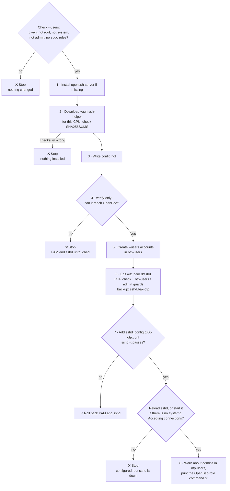

# Setting up a real server

[← Back to README](../README.md)

[`scripts/setup-otp-target.sh`](../scripts/setup-otp-target.sh) sets up a Debian or Ubuntu server to accept OTP logins. It's the same script the lab uses on its fresh `target` container ([set up the target](running-the-lab.md#set-up-the-target)), so trying it in the lab first is a full rehearsal. Each [release](https://github.com/muthanii/otp-lab/releases/latest) ships the script, `vault-ssh-helper` for amd64 and arm64, and `SHA256SUMS`, so the server needs nothing but `wget` (or `curl`):

```sh
wget -qO- https://github.com/muthanii/otp-lab/releases/latest/download/setup-otp-target.sh \
  | sudo bash -s -- --bao-addr https://bao.example.com:8200 --users user
```

The [README](../README.md#use-it-on-a-real-server) shows how to download and check the script first, read `--help`, and pin a version.

## What the script does



A released script downloads the helper from its own release, so the two always match. Running it again is safe: it doesn't duplicate PAM lines. On a server set up with an older version, it adds the group checks in front of the existing OTP check.

## Arguments

Run `./setup-otp-target.sh --help` (or `-h`) on the server to see them; it works without root and changes nothing.

| Argument | Required? | Default | What it does | Example |
|---|---|---|---|---|
| `--bao-addr URL` | **Yes** | — | Where OpenBao is. Must start with `https://` unless you also pass `--insecure-http`. The server must be able to reach it at every OTP login | `--bao-addr https://bao.example.com:8200` |
| `--users LIST` | **Yes** | — | Comma-separated accounts that may log in with an OTP. Missing ones are created with no usable password; existing ones are only added to the OTP group. The script stops before changing anything if one is `root`, a system account (uid below 1000), in `sudo`/`admin`/`wheel`, or has sudo rules. Use the OpenBao role's `default_user` | `--users user` or `--users ops,deploy` |
| `--ca-cert FILE` | No | The server's trusted CAs | The CA certificate that signed OpenBao's TLS certificate. Only needed when OpenBao uses your own CA instead of a public one like Let's Encrypt | `--ca-cert ./ca.pem` |
| `--roles LIST` | No | `otp` | Comma-separated OpenBao roles whose OTPs this server accepts. An OTP from any other role is rejected | `--roles prod-otp` |
| `--mount PATH` | No | `ssh` | Where the SSH secrets engine is enabled in OpenBao (`bao secrets enable -path=…`) | `--mount ssh-prod` |
| `--helper FILE` | No | Download from the release | Use a `vault-ssh-helper` binary you already have, for servers that can't reach GitHub. Without it, the script downloads the one for this CPU (amd64 or arm64) and checks its checksum | `--helper ./vault-ssh-helper` |
| `--otp-group NAME` | No | `otp-users` | The Linux group whose members may log in with an OTP. Created if missing; `--users` accounts are added to it | `--otp-group ssh-otp` |
| `--otp-only` | No | Off | Also turn off SSH key logins, so OTP is the only way in. Without it, keys keep working, which is your way back in if OpenBao is down | `--otp-only` |
| `--insecure-http` | No | Off | Allow `http://` for `--bao-addr`, sending OTPs unencrypted. **Labs only** | `--insecure-http` |
| `--update` | No | — | Replace this copy of the script with the latest release from GitHub (after checking its checksum) and exit. Doesn't change the server: rerun the script afterwards to apply the new version. Needs no root if you own the file. A normal run also warns when a newer release exists | `--update` |
| `-h`, `--help` | No | — | Show the help and exit, without changing anything | `--help` |

<details>
<summary>What <code>--help</code> prints</summary>

```text
setup-otp-target.sh v0.5.0
Turn a Debian/Ubuntu server into an OpenBao SSH OTP target. Run as root, and keep
an existing SSH session open until an OTP login works from a second terminal.

Usage:
  sudo ./setup-otp-target.sh --bao-addr URL --users LIST [options]
  wget -qO- https://github.com/muthanii/otp-lab/releases/latest/download/setup-otp-target.sh \
    | sudo bash -s -- --bao-addr URL --users LIST [options]

Required:
  --bao-addr URL     OpenBao's address, https://
  --users LIST       comma-separated OTP accounts; created with no usable password
                     if missing, refused if root, system (uid < 1000) or admin accounts

Options:
  --ca-cert FILE     CA that signed OpenBao's certificate (default: system's trusted CAs)
  --roles LIST       OpenBao roles allowed for this server (default: otp)
  --mount PATH       SSH engine mount path (default: ssh)
  --helper FILE      use this vault-ssh-helper instead of downloading it from the release
  --otp-group NAME   only members may log in with an OTP (default: otp-users)
  --otp-only         also turn off public-key login (default: keys keep working)
  --insecure-http    allow plain HTTP to OpenBao; labs only
  --update           replace this file with the latest release from GitHub and exit
  -h, --help         show this help and exit

OTP logins are refused for root, system accounts, accounts outside --otp-group and
members of the sudo, admin and wheel groups, so an OTP can never open an account
that can create admins.
```

</details>

## Keeping OTP accounts away from admin rights

An OTP must never open an account that can create admins. The script sets up the same layers as the lab (see [why an OTP can't open an admin account](how-it-works.md#why-an-otp-cant-open-an-admin-account)), and you finish them:

1. **Limit the role in OpenBao** to the OTP accounts on this server. Without `allowed_users`, the role issues OTPs for any username, including `root`:

   ```sh
   bao write ssh/roles/otp key_type=otp default_user=<name> allowed_users=<name>,<name2> cidr_list=<server IP>/32
   ```

2. **Name only non-admin accounts in `--users`.** The script refuses admin, system and sudo-capable accounts, creates missing ones and adds them to `otp-users`. PAM refuses OTP logins for root, system accounts (uid below 1000), anyone outside `otp-users`, and anyone in `sudo`, `admin` or `wheel`. Admins keep using keys.
3. **Read the warnings from step 8.** They cover `otp-users` members added outside the script. PAM can't see personal rules in `/etc/sudoers.d/`, so the script lists `otp-users` members that have one. Remove those rules, or that account can reach root with an OTP.

## Lab vs real server

The script does the same things in both places. Only the options differ:

| | Lab target | Real server |
|---|---|---|
| `--bao-addr` | `http://172.30.0.2:8200` | `https://…`, your OpenBao |
| `--insecure-http` | Yes (the lab's OpenBao is plain HTTP) | No |
| `--ca-cert` | No | Only if OpenBao uses your own CA |
| `--users` | `user` | The non-admin accounts that should accept OTPs |
| OpenBao role | One `otp` role for the whole lab network (`172.30.0.0/24`) | The command the script prints: this server's IP as `/32` |
| sshd | Started by the script (no systemd in containers) | Reloaded through systemd |

## Before and after running it

- **Keep your current SSH session open** until an OTP login works from a second terminal. To undo the PAM change: `cp /etc/pam.d/sshd.bak-otp /etc/pam.d/sshd`.
- **Public-key login keeps working** unless you pass `--otp-only`. That's your way in if OpenBao is down, because the server asks OpenBao at every OTP login.
- **Use the server's own interface IP** in the role's `cidr_list` and when requesting OTPs. A cloud VM behind NAT knows its private IP (e.g. `10.0.1.5`), not the public one you connect to. The script prints the right one at the end.
- **Name the role in `--roles`** rather than `*`, and give people a limited policy (see [running the lab](running-the-lab.md#a-token-that-can-only-request-otps-optional)) instead of the root token.

## Lab-only shortcuts

These are fine for the lab but not for a real server:

- OpenBao listens on plain HTTP (`tls_disable = true`), so the lab passes `--insecure-http`, which makes the helper run with `-dev`. For anything real, turn on TLS (and use `--ca-cert` if it's your own CA).
- One `otp` role covers the whole lab network (`172.30.0.0/24`) instead of one `/32` per server.
- The OpenBao container has an ssh client so it can act as the client. A real OpenBao server wouldn't run one.
- `vault-ssh-helper` is built from source by [`scripts/build-release-assets.sh`](../scripts/build-release-assets.sh) and attached to each release, because HashiCorp's download site is geo-blocked here. That applies to real servers too.
